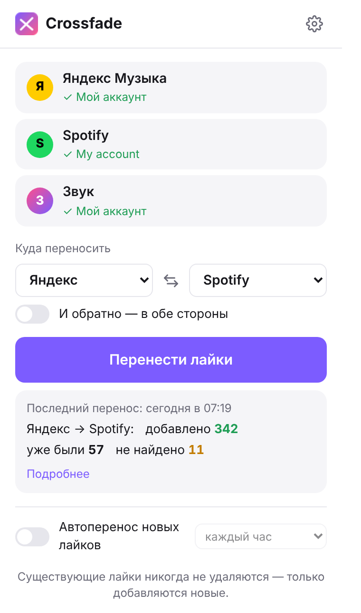
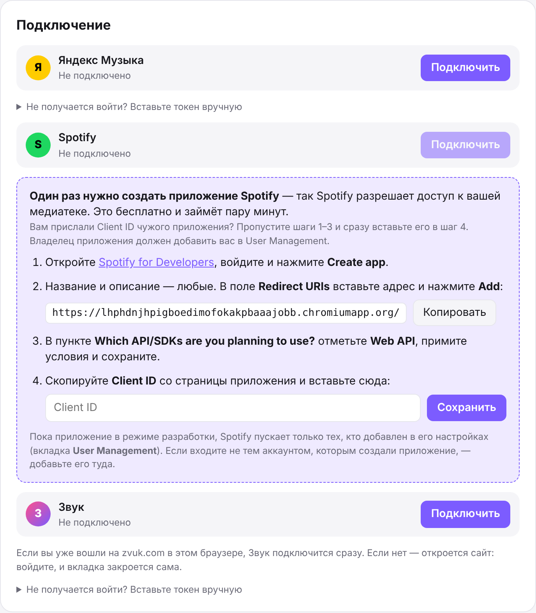
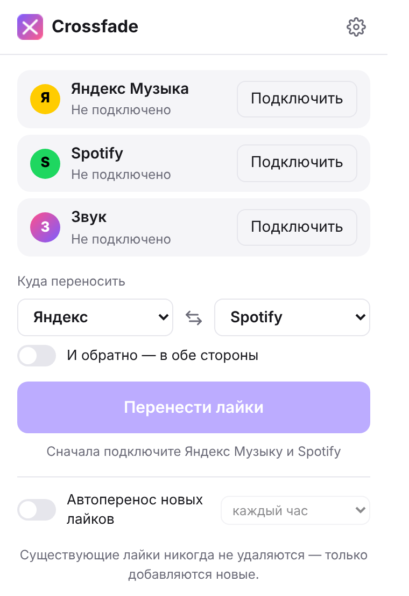
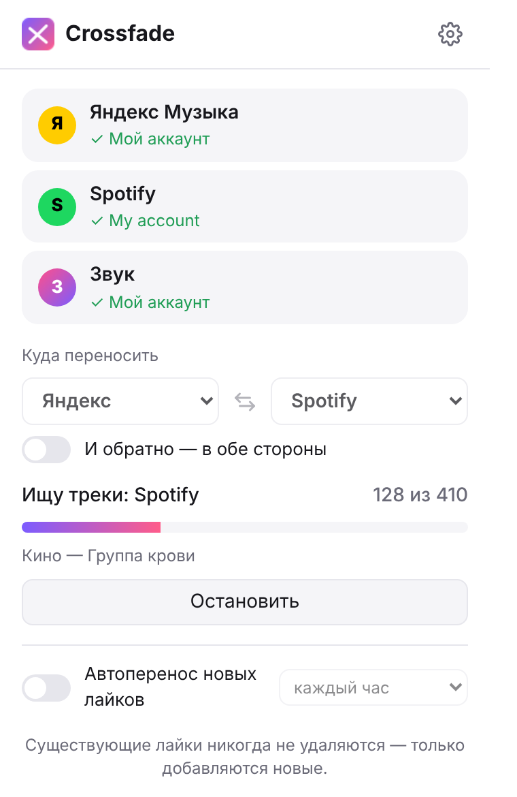

# Crossfade

Расширение для браузера, которое переносит ваши лайки между **Яндекс Музыкой**, **Spotify** и **Звуком**.
Нажали кнопку — и треки, которые вы лайкали в одном сервисе, появились в «Любимом» в другом.

<p align="center">
  
</p>

- **Ничего не удаляет.** Расширение только добавляет лайки. Всё, что уже лайкнуто, остаётся на месте.
- **В любом направлении:** из Яндекса в Spotify, из Звука в Яндекс — между любыми двумя сервисами, в одну сторону или сразу туда и обратно.
- **Переносит только новое.** Расширение помнит, что уже перенесло, поэтому повторный запуск занимает секунды.
- **Может работать само:** раз в час (или как настроите) проверяет новые лайки и переносит их.
- **Ваши данные остаются у вас.** Никаких серверов посередине: расширение общается напрямую с музыкальными сервисами,
  а данные для входа хранятся только в вашем браузере.

---

## Содержание

1. [Установка](#установка)
2. [Подключение Яндекс Музыки](#подключение-яндекс-музыки)
3. [Подключение Звука](#подключение-звука)
4. [Подключение Spotify](#подключение-spotify)
5. [Перенос лайков](#перенос-лайков)
6. [Автоматический перенос](#автоматический-перенос)
7. [Если что-то не так](#если-что-то-не-так)
8. [Обновление и удаление](#обновление-и-удаление)
9. [Для того, кто раздаёт расширение](#для-того-кто-раздаёт-расширение)

---

## Установка

Подходит **Google Chrome** и браузеры на его основе: **Яндекс Браузер**, **Microsoft Edge**, **Opera**, **Brave**.
В Firefox и Safari не работает.

Расширение ставится из папки, а не из магазина, поэтому понадобится «режим разработчика».
Это обычный переключатель в браузере, ничего опасного он не включает.

1. **Распакуйте архив** в постоянное место, например в «Документы».
   Браузер загружает расширение прямо из этой папки: если её удалить или переместить, расширение пропадёт.

2. **Откройте страницу расширений.** Скопируйте адрес в адресную строку и нажмите Enter:

   | Браузер         | Адрес                   |
   |-----------------|-------------------------|
   | Chrome, Brave   | `chrome://extensions`   |
   | Яндекс Браузер  | `browser://extensions`  |
   | Edge            | `edge://extensions`     |
   | Opera           | `opera://extensions`    |

3. **Включите «Режим разработчика».** В Chrome и Яндекс Браузере переключатель находится в правом верхнем углу,
   в Edge — в меню слева.

4. Нажмите **«Загрузить распакованное расширение»** и выберите папку **`extension`** —
   ту, внутри которой лежит файл `manifest.json`. Не выбирайте папку уровнем выше: браузер скажет, что манифест не найден.

5. **Закрепите значок на панели.** Нажмите на значок пазла 🧩 справа от адресной строки и на булавку рядом с Crossfade.

После установки сама откроется страница настроек — там подключаются сервисы.
Подключать нужно только те сервисы, между которыми хотите переносить лайки.

## Подключение Яндекс Музыки

1. Нажмите **«Подключить»** напротив Яндекс Музыки.
2. Откроется страница Яндекса. Войдите в аккаунт, где лежат ваши лайки, и разрешите доступ.
3. Вкладка закроется сама, а рядом с Яндекс Музыкой появится ✓ и имя аккаунта.

## Подключение Звука

Звук не выдаёт доступ сторонним приложениям, поэтому расширение подключается через ваш вход на сайте zvuk.com.

1. Нажмите **«Подключить»** напротив Звука.
2. Если вы уже вошли на [zvuk.com](https://zvuk.com) в этом браузере — всё, Звук подключён.
3. Если нет — откроется zvuk.com. Войдите в свой аккаунт, как обычно.
   Как только вход пройдёт, вкладка закроется сама, а рядом со Звуком появится ✓.

> У Звука нет официального API для сторонних программ. Расширение пользуется тем же, что и сайт zvuk.com.
> Если Звук что-то поменяет у себя, перенос может перестать работать до обновления расширения.

## Подключение Spotify

Spotify пускает к медиатеке только через зарегистрированное «приложение Spotify» — это запись на сайте
для разработчиков, у которой есть номер **Client ID**. Расширению нужен такой номер. Взять его можно двумя способами:

| | Вариант 1: чужое приложение | Вариант 2: своё приложение |
|---|---|---|
| **Что делать** | Получить Client ID у того, кто дал вам расширение | Создать приложение самому |
| **Сколько времени** | Минута | Минут пять |
| **От кого зависите** | Владелец приложения должен добавить вас в список пользователей | Ни от кого |
| **Когда подходит** | Вы друг или родственник владельца | Владельца нет рядом, или в его приложении закончились места |

**Как понять, что уже всё настроено.** Если на странице настроек у Spotify нет инструкции в фиолетовой рамке, а кнопка
«Подключить» активна, значит Client ID уже встроен в расширение. Убедитесь, что владелец добавил вас в список
(шаг 1 варианта 1), и сразу нажимайте «Подключить».

<p align="center">
  
</p>

### Вариант 1: подключиться через приложение другого человека

1. **Попросите владельца приложения добавить вас в список пользователей.** Сообщите ему:
   - имя (любое, просто чтобы он вас узнал);
   - **почту, на которую зарегистрирован ваш Spotify.** Посмотреть её можно на
     [spotify.com/account](https://www.spotify.com/account/) в разделе «Профиль».

   Что сделать владельцу — описано [ниже](#как-дать-доступ-к-своему-приложению-spotify).
2. **Получите от владельца Client ID** — строку из 32 цифр и латинских букв. Это не пароль, передавать его можно спокойно.
3. На странице настроек расширения вставьте Client ID в поле из шага 4 фиолетовой инструкции и нажмите **«Сохранить»**.
   Шаги 1–3 инструкции пропустите: приложение уже создано.
4. Нажмите **«Подключить»** у Spotify, войдите своим аккаунтом и разрешите доступ.

Если Spotify пишет, что не пускает аккаунт, значит владелец ещё не добавил вас или указал другую почту.

### Вариант 2: создать своё приложение Spotify

Бесплатно. Нужен только обычный аккаунт Spotify.

1. Откройте [developer.spotify.com/dashboard](https://developer.spotify.com/dashboard) и войдите
   своим аккаунтом Spotify. Если сайт попросит принять условия для разработчиков или подтвердить почту — сделайте это.
2. Нажмите **Create app** и заполните форму:
   - **App name** и **App description** — что угодно, например «Crossfade»;
   - **Redirect URIs** — нажмите «Копировать» на странице настроек расширения, вставьте адрес в поле и нажмите **Add**.
     Адрес должен быть ровно таким, со слешем на конце:
     ```
     https://lhphdnjhpigboedimofokakpbaaajobb.chromiumapp.org/
     ```
   - в пункте **Which API/SDKs are you planning to use?** отметьте **Web API**;
   - поставьте галочку согласия с условиями и нажмите **Save**.
3. На странице созданного приложения откройте **Settings** и скопируйте **Client ID**. Client Secret не нужен.
4. Вставьте Client ID на странице настроек расширения и нажмите **«Сохранить»**.
5. Нажмите **«Подключить»** у Spotify, войдите и разрешите доступ.

Аккаунт, которым вы создали приложение, пускается автоматически. Если хотите подключить другой аккаунт Spotify
или поделиться приложением с кем-то ещё — добавьте их в список пользователей, как описано ниже.

### Как дать доступ к своему приложению Spotify

Это нужно владельцу приложения, чтобы другие могли подключаться по варианту 1.

1. Откройте [developer.spotify.com/dashboard](https://developer.spotify.com/dashboard) и выберите своё приложение.
2. Перейдите в **Settings → User Management**.
3. Введите имя человека и почту его аккаунта Spotify, нажмите **Add user**.
4. Отправьте человеку свой **Client ID** (он есть в **Settings → Basic Information**).

Пока приложение в режиме разработки, Spotify ограничивает число таких пользователей. Текущий лимит показан
в User Management. Если места закончились, пусть человек создаст своё приложение по варианту 2.

## Перенос лайков

<p align="center">
  
  &nbsp;&nbsp;
  
</p>

1. Нажмите на значок Crossfade на панели браузера.
2. Выберите, **куда переносить**: в левом списке — откуда берём лайки, в правом — куда их ставим.
   Кнопка ⇄ меняет их местами. Включите **«И обратно»**, если хотите перенести лайки в обе стороны.
3. Нажмите **«Перенести лайки»**.

Окно можно закрыть: перенос продолжится в фоне. Первый перенос большой медиатеки может занять несколько минут —
каждый трек нужно найти в другом сервисе. Следующие запуски проходят быстро.

Нажали «Остановить» или закрыли браузер посередине? Ничего страшного: в следующий раз перенос продолжится с того же места.

**Что значат цифры в итогах:**

| | |
|---|---|
| **добавлено** | треки, которым расширение поставило лайк |
| **уже были** | трек нашёлся, но он и так был лайкнут — его не трогали |
| **не найдено** | такого трека нет в другом сервисе или он там записан слишком по-другому |

Ненайденные треки можно посмотреть в настройках (⚙ в окне расширения → «История»).
Рядом с каждым есть ссылка на поиск в нужном сервисе — можно найти и лайкнуть вручную.
Кнопка **«Поискать ещё раз»** повторит поиск: каталоги сервисов пополняются.

## Автоматический перенос

Включите внизу окна **«Автоперенос новых лайков»** и выберите, как часто проверять: от раза в 30 минут до раза в день.
Расширение будет само переносить новые лайки в выбранном направлении и присылать уведомление, когда что-то перенесёт.

Работает, пока открыт браузер. Если браузер был закрыт, перенос случится при следующем запуске.

## Если что-то не так

**Браузер пишет «Не удалось загрузить манифест» / «Manifest file is missing».**
Выбрана не та папка. Нужна папка `extension` — та, в которой сразу лежит `manifest.json`.

**При запуске браузер предупреждает о расширениях в режиме разработчика.**
Так браузер ведёт себя со всеми расширениями, установленными не из магазина. Просто закройте предупреждение.

**Вкладка входа в Яндекс не закрывается или вход не получается.**
На странице настроек раскройте «Не получается войти? Вставьте токен вручную». Токен Яндекс Музыки можно получить
по [инструкции](https://yandex-music.readthedocs.io/en/main/token.html).

**Звук не подключается: вкладка zvuk.com не закрывается после входа.**
Обновите страницу zvuk.com — расширение проверит вход ещё раз. Не помогло — на странице настроек раскройте
«Не получается войти? Вставьте токен вручную» у Звука и следуйте подсказке: нужно открыть
[zvuk.com/api/tiny/profile](https://zvuk.com/api/tiny/profile) и скопировать значение поля `token`.

**«Звук: запрос заблокирован защитой от ботов».**
Сайт Звука временно ограничил запросы. Подождите полчаса и запустите перенос снова — он продолжится с того же места.

**Spotify пишет «INVALID_CLIENT: Invalid redirect URI».**
В настройках приложения Spotify неправильный Redirect URI. Скопируйте его ещё раз кнопкой «Копировать» на
странице настроек расширения: нужен точный адрес со слешем на конце.

**«Spotify не пускает этот аккаунт».**
Аккаунта нет в User Management приложения Spotify — добавьте его туда (см. [Подключение Spotify](#подключение-spotify)).

**«Вход устарел, подключите сервис заново».**
Сервис перестал принимать сохранённый вход — например, вы сменили пароль. Нажмите «Отключить» и «Подключить» в настройках.

**Нашёлся не тот трек.**
Бывает с каверами и треками с одинаковыми названиями. Снимите лайк с этого трека вручную — повторно расширение его не поставит.

**Хочу перенести всё заново с нуля.**
В настройках есть кнопка «Сбросить историю переносов». Лайки в сервисах при этом не меняются — расширение просто
заново проверит все треки.

## Обновление и удаление

**Обновление.** Замените содержимое папки `extension` новой версией, откройте страницу расширений и нажмите
кнопку обновления (круглая стрелка) на карточке Crossfade. Подключения, настройки и история сохранятся.

**Удаление.** Нажмите «Удалить» на карточке Crossfade на странице расширений. Все лайки в сервисах останутся как есть.
Если создавали приложение Spotify, его можно удалить на [developer.spotify.com/dashboard](https://developer.spotify.com/dashboard).

---

## Для того, кто раздаёт расширение

### Чтобы друзьям не пришлось создавать приложение Spotify

Друзья могут подключаться через ваше приложение Spotify (вариант 1). Добавьте каждого в **User Management**
([как это сделать](#как-дать-доступ-к-своему-приложению-spotify)), а Client ID передайте одним из способов:

- **Отправьте его вместе с архивом.** Друг вставит его на странице настроек.
- **Встройте его в расширение,** тогда вставлять ничего не придётся. Откройте `extension/config.js` и впишите:
  ```js
  export const SPOTIFY_CLIENT_ID = "ваш_client_id";
  ```
  Инструкция в фиолетовой рамке тогда пропадёт, у Spotify останется только кнопка «Подключить».
  Минус: создать своё приложение (вариант 2) с такой сборкой уже не получится. Если друзей больше, чем мест
  в User Management, оставьте `config.js` пустым.

### Как собрать архив

Заархивируйте папку `extension` вместе с этим README и отправьте. Или, если репозиторий на GitHub публичный,
дайте ссылку: **Code → Download ZIP** скачает всё сразу.

Не меняйте поле `key` в `manifest.json`: от него зависит адрес возврата для Spotify.
Пока ключ тот же, у всех один и тот же Redirect URI и сохраняются данные при обновлении.

### Устройство проекта

```
extension/
  manifest.json          — описание расширения (Manifest V3)
  config.js              — Client ID Spotify
  background.js          — фоновая работа: вход, перенос, расписание
  lib/
    catalog.js           — список сервисов и настройки направления
    matching.js          — сравнение треков: ISRC, название, исполнители, длительность, транслит
    sync.js              — перенос и учёт уже перенесённого
    auth.js              — вход в сервисы
    http.js              — запросы с повтором при лимитах API
    headers.js           — подмена заголовков, без которой API Яндекса и Звука отклоняют запросы
    services/yandex.js   — API Яндекс Музыки
    services/spotify.js  — Spotify Web API
    services/zvuk.js     — GraphQL API сайта zvuk.com
  ui/                    — окно расширения и страница настроек
tests/                   — тесты
```

Тесты запускаются без установки зависимостей, нужен только Node.js 20+:

```bash
npm test
```

Чтобы добавить другой сервис, напишите класс с методами `getLikedTracks`, `search`, `searchUrl` и `like`
по образцу `extension/lib/services/`, добавьте его в `lib/catalog.js` и `background.js`
и строку с кнопкой «Подключить» в `ui/popup.html` и `ui/options.html`.
